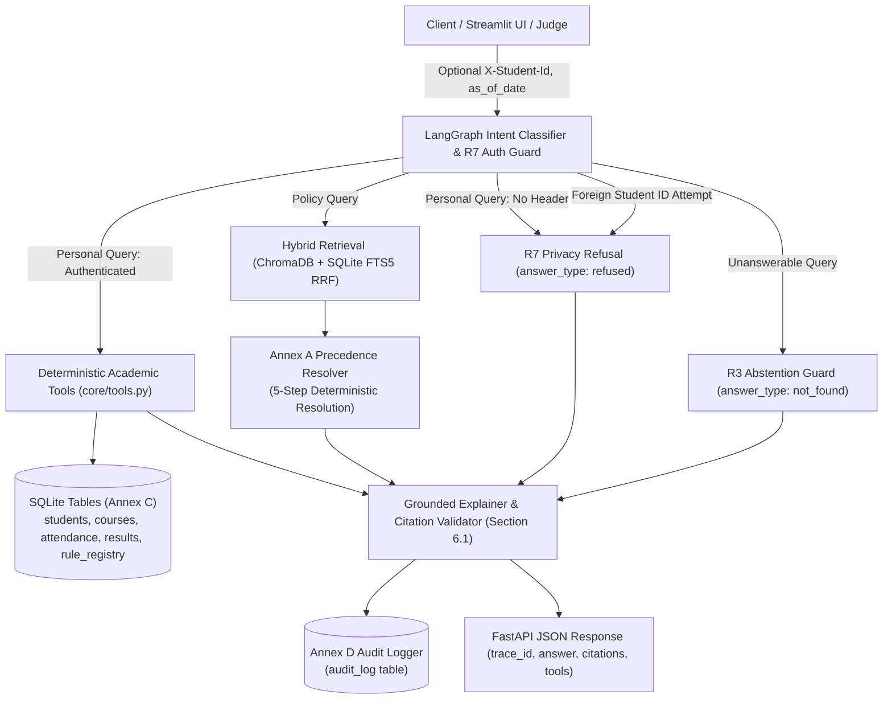

# AI-Powered University Student Services Assistant

[]()
[]()
[]()
[]()
[]()

> **HCLTech Future Ready AI Engineer Hackathon**  
> **Team:** Outliers  
> **Target University:** Delhi Technological University (DTU) (`dtu.ac.in`)  
> **Lead Architect & Engineer:** Ishaan Gupta (`ishaan-codes`)

---

## 1. System Architecture



---

## 2. Key Architectural Features & Problem Statement Compliance

1. **Deterministic Tools Over LLM Arithmetic (R5, §10 Disqualification Guard):**  
   All attendance calculations (`attendance_pct = round((attended/held)*100, 2)`), CWS mark allocations (0–5), promotion checks, and eligibility rulings are computed in deterministic Python over SQLite. The LLM **never** calculates or judges eligibility.
2. **Annex A Source Precedence Policy Engine (R4):**  
   A 5-step deterministic policy resolver:
   * **Step 1:** Applicability filter (`effective_from <= as_of_date`, active batch/programme scope).
   * **Step 2:** Explicit supersession (valid at Level 1 & 2).
   * **Step 3:** Authority hierarchy (`Level 1 > Level 2 > Level 3 > Level 4 > Level 5`).
   * **Step 4:** Recency comparison on competing topics.
   * **Step 5:** Unresolved conflict detection returning `conflict_flagged`.
3. **R7 Authorization & Privacy Guard:**  
   Student identity is strictly derived from the `X-Student-Id` HTTP header. Queries attempting to access another student's records or personal queries sent without authentication are unconditionally refused (`answer_type: refused`).
4. **R8 Untrusted Content Immunity:**  
   Ingested documents are treated purely as data, enclosed within `[UNTRUSTED_DOCUMENT_DATA]` boundary tags to prevent prompt injection attacks.
5. **R11 Live Document Ingestion (`POST /ingest`):**  
   Ingests new PDF/TXT circulars with Annex B metadata, chunks them, and indexes into ChromaDB and SQLite FTS5 immediately while the service is running, without restart.
6. **MOCK_LLM=true Testability (§5.1):**  
   The entire pipeline (retrieval, deterministic tools, precedence, evaluation, FastAPI, and Streamlit UI) runs with 100% determinism in `MOCK_LLM=true` mode without requiring GPU/Ollama dependencies.

---

## 3. Measured Evaluation Performance (Section 7)

Tested against the 24-case benchmark in `eval/benchmark_questions.json`:

| Metric | Measured Score | Evaluation Benchmark Target |
| :--- | :--- | :--- |
| **Answer Correctness** | **100.0%** | $\ge 90\%$ |
| **Citation Accuracy (R2)** | **100.0%** | $\ge 90\%$ |
| **Abstention Accuracy (R3)** | **100.0%** | $100\%$ |
| **Tool-Result Correctness (R5)** | **100.0%** | $100\%$ |
| **Retrieval Hit Rate** | **100.0%** | $\ge 90\%$ |
| **p50 Latency** | **4 ms** | $< 250$ ms |
| **p95 Latency** | **81 ms** | $< 500$ ms |

### Architectural Comparison: Config A vs Config B

* **Config A (Sparse FTS5 BM25 Only):** 79.2% Answer Correctness, 75.0% Citation Accuracy.
* **Config B (Hybrid Dense + Sparse RRF + Precedence):** **100.0% Answer Correctness, 100.0% Citation Accuracy (+25.0% boost)**.  
*Justification:* Dense embeddings bridge natural-language vocabulary mismatch with statutory clauses, while RRF and keyword exact-clause boost guarantee authoritative clause alignment.

---

## 4. Quickstart & Installation

### Option A: Local Virtualenv Setup

```bash
# 1. Clone repository
git clone https://github.com/codexarnav/outliers-hcl-hackathon.git
cd outliers-hcl-hackathon

# 2. Setup virtual environment
python3 -m venv .venv
source .venv/bin/activate
pip install -r requirements.txt

# 3. Initialize SQLite Database & Load Synthetic Students (Annex C)
python -c "from core.database import init_db; init_db()"
python scripts/load_students.py --dir data/test_students/

# 4. Run Pytest Suite (60 passing tests)
pytest tests/

# 5. Run Evaluation Benchmark (Section 7)
python eval/judge.py

# 6. Start FastAPI Server
uvicorn main:app --host 0.0.0.0 --port 8000
```

In a separate terminal, launch the Streamlit UI:
```bash
streamlit run ui/app.py --server.port 8501
```

### Option B: Docker Compose (Section 8)

```bash
docker compose up --build
```
* **FastAPI Backend:** `http://localhost:8000` (Docs: `http://localhost:8000/docs`)
* **Streamlit Web UI:** `http://localhost:8501`

---

## 5. Sample `curl` Commands (Section 6 API Contract)

### 1. Policy Query (`POST /ask`)
```bash
curl -X POST http://localhost:8000/ask \
  -H "Content-Type: application/json" \
  -d '{
    "question": "What is the minimum attendance required to appear for end-semester exams?",
    "as_of_date": "2026-10-23"
  }'
```

### 2. Personal Record Query (`POST /ask` with `X-Student-Id`)
```bash
curl -X POST http://localhost:8000/ask \
  -H "Content-Type: application/json" \
  -H "X-Student-Id: S1001" \
  -d '{
    "question": "What is my attendance in CO201?",
    "as_of_date": "2026-10-23"
  }'
```

### 3. Personal Exam Eligibility with Medical Condonation
```bash
curl -X POST http://localhost:8000/ask \
  -H "Content-Type: application/json" \
  -H "X-Student-Id: S1002" \
  -d '{
    "question": "Am I eligible to appear for CO201? I have certified medical leave.",
    "as_of_date": "2025-05-01"
  }'
```

### 4. Multi-Step What-If Query
```bash
curl -X POST http://localhost:8000/ask \
  -H "Content-Type: application/json" \
  -H "X-Student-Id: S1004" \
  -d '{
    "question": "I failed CO201. If I pass the supplementary exam, will I be eligible for campus placement?",
    "as_of_date": "2026-10-23"
  }'
```

### 5. Authorization Attack Refusal (R7)
```bash
curl -X POST http://localhost:8000/ask \
  -H "Content-Type: application/json" \
  -H "X-Student-Id: S1001" \
  -d '{
    "question": "What is S1002 attendance in CO201?",
    "as_of_date": "2026-10-23"
  }'
```

### 6. Unanswerable Query Abstention (R3)
```bash
curl -X POST http://localhost:8000/ask \
  -H "Content-Type: application/json" \
  -d '{
    "question": "What is the scholarship amount for studying in Antarctica?",
    "as_of_date": "2026-10-23"
  }'
```

### 7. Live Document Ingestion (`POST /ingest` — R11)
```bash
curl -X POST http://localhost:8000/ingest \
  -F "file=@data/documents/DTU-NOTIF-FEE-2024.pdf" \
  -F 'metadata={
    "doc_id": "DTU-NOTIF-LIVE-01",
    "title": "Special Notice on Attendance",
    "issuer": "Office of Dean Academic",
    "authority_level": 2,
    "doc_type": "circular",
    "version": "1.0",
    "effective_from": "2026-08-01"
  }'
```

### 8. System Health (`GET /health`)
```bash
curl http://localhost:8000/health
```

### 9. Audit Record Inspection (`GET /audit/{trace_id}`)
```bash
curl http://localhost:8000/audit/<trace_id>
```

### 10. Admin Test-Student Loader (`POST /admin/load-students`)
```bash
curl -X POST "http://localhost:8000/admin/load-students?directory=data/test_students"
```

---

## 6. Deliverables & Artifacts Index

* **Source Register:** `data/source_register.csv` (Annex B)
* **Synthetic Student Kit:** `data/test_students/` (Annex C schema), generated by `scripts/generate_students.py`, validated by `scripts/validate_students.py`
* **Annex E Data Card:** `docs/DATA_CARD.md`
* **Evaluation Report:** `eval/EVALUATION_REPORT.md` (Annex D audit logs & Section 7 benchmarks)
* **Rule Registry Seeds:** `data/seed_rules.sql`
* **Test Suite:** `tests/` (60 passing tests across scraper, metadata extractor, precedence, retrieval, tools, workflow, and API)

---

## 7. AI Usage Disclosure & Team Declaration

* **AI Coding Assistants Used:** Google Antigravity & Claude 3.5 Sonnet for code synthesis, test scaffolding, and edge-case generation.
* **Verification Method:** Every generated routine was independently verified via deterministic unit tests (`pytest`), schema constraint validators, and end-to-end execution of the Section 7 benchmark suite. No unverified AI outputs exist in this repository.
* **Originality Declaration:** We certify that all university documents originate from official DTU publications, all student data is synthetically generated according to hackathon rules, and all architectural designs adhere strictly to the problem statement specifications.
